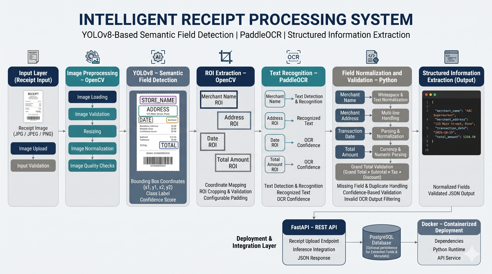

# Intelligent Receipt Processing System
### YOLOv8-Based Document Intelligence and Information Extraction

An automated receipt information extraction system that combines **YOLOv8, PaddleOCR, and OpenCV** to detect and extract essential business information from semi-structured receipt images.

The system identifies four key fields:

- Merchant Name
- Merchant Address
- Transaction Date
- Total Amount

Instead of applying OCR to the entire receipt and processing all detected text, the system uses object detection to localize relevant semantic fields before extracting their text using OCR.

---

## 1. Project Overview

| Attribute | Description |
|---|---|
| Project | Intelligent Receipt Processing System |
| Domain | Computer Vision / Document Intelligence |
| Detection Model | YOLOv8 |
| OCR Engine | PaddleOCR |
| Image Processing | OpenCV |
| Backend | FastAPI |
| Deployment | Docker |
| Database | PostgreSQL |
| Output | Structured JSON |

### Problem Statement

Receipts contain multiple information fields, including merchant details, transaction dates, item descriptions, taxes, discounts, subtotals, and final payable amounts.

Extracting specific information reliably is challenging because of:

- Variations in receipt layouts and text positions.
- Different image resolutions and document quality.
- Multi-line merchant addresses.
- Inconsistent date and currency formats.
- Multiple monetary values appearing on the same receipt.
- OCR recognition errors.

### Proposed Solution

A two-stage computer vision pipeline:

1. **YOLOv8 Detection:** Localizes the four required semantic fields using bounding boxes.
2. **PaddleOCR Recognition:** Extracts text from the detected regions, followed by field-specific normalization and validation.

The final output is a structured JSON response.

---

## 2. System Architecture




### Processing Flow

```text
                 RECEIPT IMAGE
                       |
                       v
              Image Preprocessing
                    OpenCV
                       |
                       v
                YOLOv8 Detector
                       |
                       v
              Semantic Field Detection
                       |
       +---------------+---------------+
       |               |               |
       v               v               v
   STORE_NAME       ADDRESS          DATE
                       |
                    TOTAL
                       |
                       v
                 ROI Extraction
              Bounding Box Validation
                       |
                       v
                  PaddleOCR
               Text Recognition
                       |
                       v
              Post-processing
          Normalization and Validation
                       |
                       v
              Structured JSON Output
                       |
                       v
                  FastAPI API
                       |
                       v
                 Application
```

### YOLOv8 Detection Classes

| Class ID | Class Name | Description |
|---|---|---|
| 0 | STORE_NAME | Merchant or store name |
| 1 | ADDRESS | Merchant address |
| 2 | DATE | Transaction date |
| 3 | TOTAL | Final payable amount |

---

## 3. Technical Implementation

### Stage 1: Image Preprocessing

**Technology:** Python, OpenCV

- Load and validate receipt images.
- Inspect image dimensions and quality.
- Resize images according to model input requirements.
- Prepare images for object detection.
- Maintain coordinate consistency when mapping predictions back to original images.

### Stage 2: Semantic Field Detection

**Technology:** YOLOv8

A multi-class object detection model identifies the four required receipt fields.

The detector predicts:

- Bounding-box coordinates.
- Semantic class labels.
- Detection confidence scores.

The objective is to localize relevant information rather than process the entire receipt as unstructured text.

### Stage 3: ROI Extraction

**Technology:** Python, OpenCV

Detected bounding boxes are used to extract individual Regions of Interest (ROIs).

The extraction process includes:

1. Retrieve predicted bounding-box coordinates.
2. Map coordinates to original image dimensions when required.
3. Validate bounding-box boundaries.
4. Apply configurable padding where necessary.
5. Crop the detected region.
6. Prepare the ROI for OCR.

### Stage 4: OCR Recognition

**Technology:** PaddleOCR

Each detected ROI is passed to PaddleOCR for text recognition.

| Detected Region | Extracted Information |
|---|---|
| STORE_NAME | Merchant name |
| ADDRESS | Merchant address |
| DATE | Transaction date |
| TOTAL | Final payable amount |

### Stage 5: Post-processing and Validation

Extracted OCR text is normalized according to the expected data type.

| Field | Processing |
|---|---|
| Merchant Name | Whitespace cleanup and text normalization |
| Address | Multi-line text handling |
| Date | Date-format normalization and validation |
| Total Amount | Currency-symbol handling and numeric validation |

**Total Amount Disambiguation**

Receipts can contain subtotal, tax, discounts, cash received, change, and grand total.

The system focuses on extracting the final payable amount rather than treating every monetary value as the transaction total.

The validation stage should also account for missing detections, duplicate predictions, invalid OCR output, and low-confidence results.

### Stage 6: Structured Output

The extracted fields are assembled into a structured JSON response.

Example:

```json
{
  "success": true,
  "data": {
    "merchant_name": "Kevar Supermarket",
    "merchant_address": "123 Main Street, Pune",
    "transaction_date": "2024-10-15",
    "total_amount": 1250.50
  }
}
```

*Example output for demonstration purposes.*

---

## 4. Model Evaluation and Performance

The system is evaluated across three primary levels:

1. Object detection performance.
2. Field-level text extraction performance.
3. End-to-end structured information extraction.

### 4.1 Overall Performance

| Metric | Result |
|---|---:|
| YOLOv8 mAP@50 | **96.2%** |
| Field Detection Recall | **94.5%** |
| Date Extraction Accuracy | **97.2%** |
| Total Amount Extraction Accuracy | **96.4%** |
| Four-Field Exact Match | **88.5%** |
| Average Inference Latency | **1.8 seconds/receipt** |

### 4.2 Object Detection Evaluation

| Metric | Description | Result |
|---|---|---:|
| Precision | Correct detections among all predicted detections | **97.6%** |
| Recall | Ground-truth objects successfully detected | **94.5%** |
| mAP@50 | Mean Average Precision at IoU 0.50 | **96.2%** |
| mAP@50:95 | Mean AP across IoU thresholds 0.50–0.95 | **93.6%** |

### 4.3 Field-Level Extraction Evaluation

| Field | Evaluation Target | Accuracy |
|---|---|---:|
| Merchant Name | Correct merchant name | Not reported |
| Merchant Address | Correct merchant address | **96.1%** |
| Transaction Date | Correct normalized date | **97.2%** |
| Total Amount | Correct final payable amount | **96.4%** |

### 4.4 End-to-End Evaluation

| Metric | Description | Result |
|---|---|---:|
| Four-Field Exact Match | All four fields correctly extracted from one receipt | **88.5%** |

A receipt is considered an exact match only when all four normalized fields match their corresponding ground-truth values.

### 4.5 OCR Evaluation

| Metric | Description | Result |
|---|---|---:|
| Character Error Rate (CER) | Character-level recognition error | **97.8%** |
| Word Error Rate (WER) | Word-level recognition error | **95.2%** |

## 5. Engineering Challenges and Solutions

| Challenge | Technical Approach |
|---|---|
| Different receipt layouts | YOLOv8-based semantic field detection |
| Isolating relevant text | Bounding-box-based ROI extraction |
| Incorrect ROI coordinates | Coordinate validation and boundary handling |
| Multi-line addresses | Field-specific text normalization |
| Inconsistent date formats | Date parsing and validation |
| Multiple monetary values | Semantic total localization and amount validation |
| OCR recognition errors | Field-specific preprocessing and post-processing |
| Missing or uncertain fields | Confidence-aware validation and exception handling |

---

## 6. Backend and Deployment

### FastAPI Integration

**Technology:** FastAPI

The inference pipeline is exposed through API endpoints for receipt image submission and structured extraction.

| Method | Endpoint | Purpose |
|---|---|---|
| POST | `/api/v1/receipts/extract` | Upload receipt and extract information |
| GET | `/api/v1/health` | Application health check |

Example request:

```http
POST /api/v1/receipts/extract
Content-Type: multipart/form-data
```

The API accepts a receipt image and returns the extracted fields in JSON format.

### Docker Deployment

**Technology:** Docker

Docker is used to package the application and its dependencies into a consistent runtime environment.

Build the image:

```bash
docker build -t receipt-ocr-system .
```

Run the application:

```bash
docker run -p 8000:8000 receipt-ocr-system
```

FastAPI documentation:

```text
http://localhost:8000/docs
```

*Adjust commands and endpoint paths to match the actual implementation.*

---

## 7. Technology Stack

| Category | Technologies |
|---|---|
| Programming Language | Python |
| Object Detection | YOLOv8 |
| OCR | PaddleOCR |
| Image Processing | OpenCV |
| Backend | FastAPI |
| Database | PostgreSQL |
| Containerization | Docker |
| Output Format | JSON |
| Evaluation | Precision, Recall, mAP, CER, WER, Exact Match |

---

## 8. Future Improvements

- Evaluate model generalization across additional receipt layouts and image qualities.
- Improve OCR recognition for low-resolution and multi-line text regions.
- Introduce confidence calibration and human review for ambiguous extractions.
- Optimize inference latency and support batch receipt processing.

---

## 9. Project Highlights

- YOLOv8-based semantic detection of four receipt information fields.
- ROI-based OCR processing using PaddleOCR.
- Field-specific text normalization and validation.
- Disambiguation of final payable amount from other monetary values.
- Structured information extraction through FastAPI.
- Docker-based application packaging.
- Multi-level evaluation covering detection, extraction, and inference performance.

---

